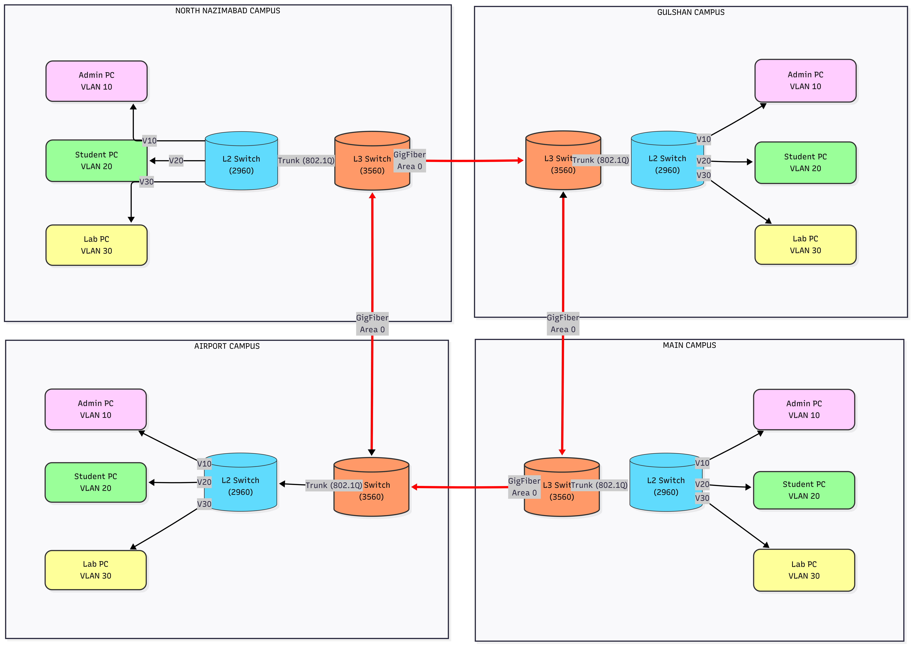
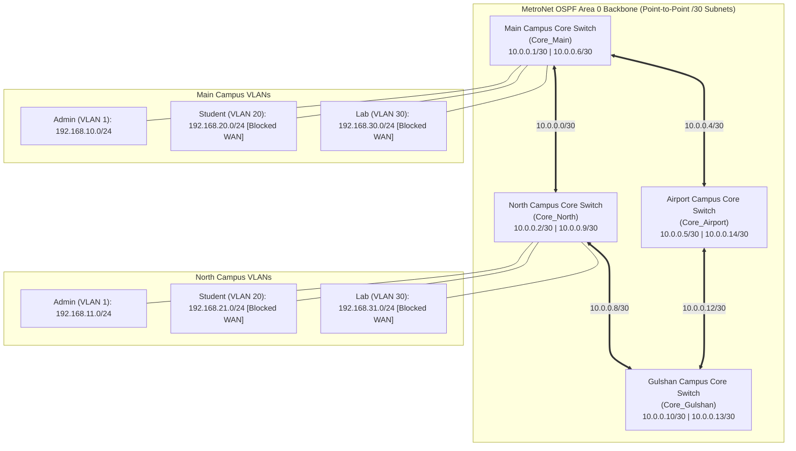

# 🌐 MetroNet: Enterprise Campus OSPF Backbone

[](https://www.netacad.com/courses/packet-tracer)
[-blue.svg)]()
[]()
[-orange.svg)]()
[]()
[](https://opensource.org/licenses/MIT)

> **MetroNet** is a scalable, resilient Metropolitan Area Network (MAN) infrastructure connecting four university campuses (**Main**, **North**, **Airport**, and **Gulshan**). Engineered in **Cisco Packet Tracer**, it integrates dynamic **OSPFv2 (Single Area 0)** routing over Gigabit point-to-point links, **Layer 3 Multilayer Switches (Switch Virtual Interfaces - SVIs)**, **VLSM** subnetting, centralized **DHCP Relay**, and **Zero-Trust Access Control Lists (ACLs)** to isolate student traffic while ensuring seamless administrative connectivity.

---

## 📌 Table of Contents
- [Executive Overview](#-executive-overview)
- [Network Topology & Architecture](#-network-topology--architecture)
- [VLSM IP Addressing & Subnet Schema](#-vlsm-ip-addressing--subnet-schema)
- [Core Technologies & Implementation](#-core-technologies--implementation)
  - [1. Dynamic Routing Architecture (OSPF Area 0)](#1-dynamic-routing-architecture-ospf-area-0)
  - [2. Layer 3 Inter-VLAN Routing (SVIs)](#2-layer-3-inter-vlan-routing-svis)
  - [3. Zero-Trust Campus Isolation & DHCP Relay](#3-zero-trust-campus-isolation--dhcp-relay)
- [Verification & Troubleshooting Command Suite](#-verification--troubleshooting-command-suite)
- [Repository Structure](#-repository-structure)
- [How to Run in Cisco Packet Tracer](#-how-to-run-in-cisco-packet-tracer)
- [Contributing & License](#-license)

---

## 🏢 Executive Overview

Multi-campus enterprise networks must reconcile high-throughput administrative communication with robust network segmentation. **MetroNet** solves this challenge through a multi-tiered design:

- **Full-Mesh MAN Core**: High-speed Gigabit routed links interconnecting campus core switches.
- **Dynamic Convergence**: OSPF Area 0 ensures sub-second route calculation and fault tolerance should a WAN transit link fail.
- **Zero-Trust Security Boundary**: Student and Laboratory networks are strictly confined to their local campus LAN. Inter-campus WAN links are reserved exclusively for administrative traffic and critical centralized servers.

---

## 🗺️ Network Topology & Architecture



### High-Level Topology Architecture



---

## 📊 VLSM IP Addressing & Subnet Schema

### 1. Campus Local Area Networks (/24 Subnets)
| Campus | VLAN 1 (Administration) | VLAN 20 (Students) | VLAN 30 (Laboratories) | Gateway IP |
|---|---|---|---|:---:|
| **Main Campus** | `192.168.10.0/24` | `192.168.20.0/24` | `192.168.30.0/24` | `.1` |
| **North Campus** | `192.168.11.0/24` | `192.168.21.0/24` | `192.168.31.0/24` | `.1` |
| **Airport Campus** | `192.168.12.0/24` | `192.168.22.0/24` | `192.168.32.0/24` | `.1` |
| **Gulshan Campus** | `192.168.13.0/24` | `192.168.23.0/24` | `192.168.33.0/24` | `.1` |

### 2. Inter-Campus WAN Transit Links (/30 Point-to-Point)
| Link Segment | Subnet | Link End A | Link End B | Subnet Mask |
|---|:---:|---|---|:---:|
| **Main $\leftrightarrow$ North** | `10.0.0.0/30` | Main `Gi0/1` (`10.0.0.1`) | North `Gi0/1` (`10.0.0.2`) | `255.255.255.252` |
| **Main $\leftrightarrow$ Airport** | `10.0.0.4/30` | Main `Gi0/2` (`10.0.0.6`) | Airport `Gi0/1` (`10.0.0.5`) | `255.255.255.252` |
| **North $\leftrightarrow$ Gulshan** | `10.0.0.8/30` | North `Gi0/2` (`10.0.0.9`) | Gulshan `Gi0/1` (`10.0.0.10`) | `255.255.255.252` |
| **Airport $\leftrightarrow$ Gulshan** | `10.0.0.12/30` | Airport `Gi0/2` (`10.0.0.14`) | Gulshan `Gi0/2` (`10.0.0.13`) | `255.255.255.252` |

---

## ⚙️ Core Technologies & Implementation

### 1. Dynamic Routing Architecture (OSPF Area 0)
Configured across all four Layer 3 Core Multilayer Switches (e.g., `Core_Main`):
```cisco
ip routing
!
interface GigabitEthernet0/1
 no switchport
 ip address 10.0.0.1 255.255.255.252
!
interface GigabitEthernet0/2
 no switchport
 ip address 10.0.0.6 255.255.255.252
!
router ospf 1
 log-adjacency-changes
 network 192.168.10.0 0.0.0.255 area 0
 network 10.0.0.0 0.0.0.3 area 0
 network 10.0.0.4 0.0.0.3 area 0
```
- **Routed Ports (`no switchport`)**: Converts physical switch ports into Layer 3 interfaces with dedicated IP addresses, bypassing STP overhead and providing wire-speed Layer 3 routing.
- **Link State Advertisements (LSAs)**: Propagate topology changes dynamically across the network.

### 2. Layer 3 Inter-VLAN Routing (SVIs)
```cisco
interface Vlan1
 ip address 192.168.10.1 255.255.255.0
!
interface Vlan20
 ip address 192.168.20.1 255.255.255.0
 ip helper-address 192.168.10.10
 ip access-group CAMPUS_ISOLATION in
!
interface Vlan30
 ip address 192.168.30.1 255.255.255.0
 ip helper-address 192.168.10.10
 ip access-group CAMPUS_ISOLATION in
```

### 3. Zero-Trust Campus Isolation & DHCP Relay
- **DHCP Relay (`ip helper-address 192.168.10.10`)**: Unicasts broadcast DHCP DISCOVER packets from student and lab VLANs directly to the centralized DHCP server on the Admin network.
- **Campus Isolation Policy**:
```cisco
ip access-list extended CAMPUS_ISOLATION
 permit udp any any eq bootps
 permit udp any any eq bootpc
 permit icmp any any echo-reply
 permit ip 192.168.20.0 0.0.0.255 192.168.30.0 0.0.0.255
 permit ip 192.168.30.0 0.0.0.255 192.168.20.0 0.0.0.255
 deny ip any any
```
Students and Lab PCs can communicate locally within the campus and obtain DHCP configurations, but are strictly blocked from traversing WAN links to access other campuses or administrative subnets.

---

## 🔍 Verification & Troubleshooting Command Suite

```cisco
# Verify OSPF Adjacency States (Should report FULL/BDR or FULL/DR)
Core_Main# show ip ospf neighbor

# Inspect OSPF Routing Table Entries
Core_Main# show ip route ospf

# Validate Layer 3 Interface Status
Core_Main# show ip interface brief

# Check Access-List Hit Counts
Core_Main# show access-lists CAMPUS_ISOLATION
```

### Reachability Matrix
| Source | Destination | Protocol / Port | Result |
|---|---|:---:|:---:|
| **Admin PC (Main)** | Admin PC (Gulshan) | ICMP / Any | ✅ **REACHABLE** |
| **Admin PC (Main)** | Student PC (Any) | ICMP Echo Request | ✅ **REACHABLE** |
| **Student PC (Main)** | Student PC (Main Local) | HTTP / File Share | ✅ **PERMITTED** |
| **Student PC (Main)** | Admin PC (Main) | Any IP | 🛑 **BLOCKED** |
| **Student PC (Main)** | Any Remote Campus PC | Any IP | 🛑 **BLOCKED (WAN ISOLATION)** |

---

## 📁 Repository Structure

```
metronet-campus-ospf/
├── assets/
│   └── topology-block-diagram.png     # Full high-resolution network architecture diagram
├── configs/
│   ├── main-campus-switch.txt         # Core_Main Cisco 3560 switch startup configuration
│   ├── north-campus-switch.txt        # Core_North Cisco 3560 switch startup configuration
│   ├── airport-campus-switch.txt      # Core_Airport Cisco 3560 switch startup configuration
│   └── gulshan-campus-switch.txt      # Core_Gulshan Cisco 3560 switch startup configuration
├── docs/
│   ├── metronet-project-report.docx   # Comprehensive academic engineering report
│   ├── metronet-proposal.docx         # Project charter & architecture proposal
│   └── ip-distribution-plan.docx      # Detailed VLSM IP allocation matrix
├── packet-tracer/
│   └── metronet-enterprise-man.pkt    # Interactive Cisco Packet Tracer topology simulation
├── .gitignore                         # Git ignore rules
└── README.md                          # Project documentation
```

---

## 🔌 How to Run in Cisco Packet Tracer

1. Download and install **Cisco Packet Tracer** (v8.0+).
2. Clone this repository:
   ```bash
   git clone https://github.com/jahanzaib-147/metronet-campus-ospf.git
   cd metronet-campus-ospf
   ```
3. Open `packet-tracer/metronet-enterprise-man.pkt`.
4. Allow 30–45 seconds for Spanning Tree Protocol (STP) and OSPF neighbor adjacencies to converge (green link lights).
5. Open terminal on `Admin PC (Main Campus)` and ping `Admin PC (Gulshan Campus)`:
   ```cmd
   ping 192.168.13.2
   ```
   *(Initial packet may ARP, followed by 100% success).*

---

## 📄 License

This project is licensed under the [MIT License](LICENSE).
